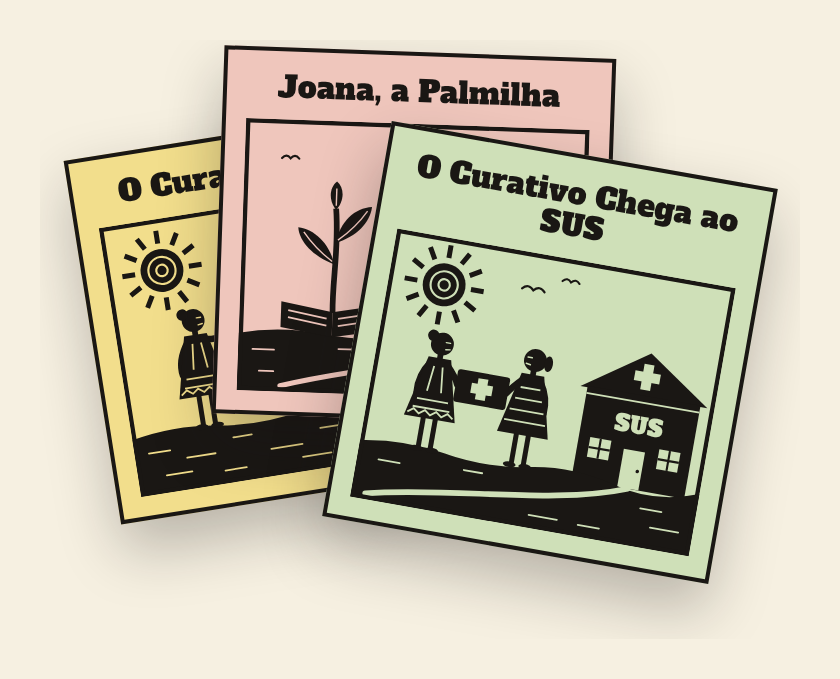

# Trilogia Inova UNCISAL

  

Inovação em versos de cordel. Três folhetos do Núcleo de Inovação Tecnológica da Universidade Estadual de Ciências da Saúde de Alagoas (NIT UNCISAL) para pesquisadores e estudantes: como proteger uma ideia, transformá-la em negócio e fazê-la chegar ao paciente do SUS.

## Os folhetos

| Folheto | Tema | Forma |
| --- | --- | --- |
| 1. O Curativo de Rita e os Segredos da Propriedade Intelectual | Proteger: patentes, modelo de utilidade, desenho industrial, marcas, indicação geográfica, direito autoral, programa de computador, cultivares, conhecimento tradicional e o papel do NIT | 34 sextilhas, miolo de 16 páginas |
| 2. Joana, a Palmilha e o Caminho do Empreendedor | Empreender: empreendedorismo na universidade, empresa júnior, incubação, startups e parque tecnológico | 28 sextilhas, miolo de 12 páginas |
| 3. O Curativo Chega ao SUS: do laboratório ao paciente | Chegar: licenciamento, pesquisa clínica, regularização na Anvisa e incorporação ao SUS | 24 sextilhas, miolo de 12 páginas |

Todos os folhetos são escritos em sextilhas de redondilha maior, com rima nos versos pares, e terminam com o acróstico INOVA UNCISAL.

## Arquivos

| Arquivo | Conteúdo |
| --- | --- |
| `index.html` | Página de entrada da trilogia |
| `folheto1.html`, `folheto2.html`, `folheto3.html` | Visualizadores dos folhetos |

Cada arquivo é uma página independente, sem dependências além das fontes do Google Fonts.

## Como ler

- **No computador:** o folheto abre como um livro, com duas páginas lado a lado. Vire com um clique, pelos botões ou pelas setas do teclado.
- **No celular:** uma página por vez. Toque nas bordas da página ou deslize o dedo.
- **Para ouvir:** toque em "Ouvir página" ou "Ouvir folheto". A declamação usa a voz sintética do aparelho, com destaque da estrofe declamada. A gravação na voz do autor será incorporada em versão futura.

Cada folheto reproduz a estrutura do impresso: capa de quatro páginas em papel colorido (capa, capa interna, contracapa interna e contracapa) e miolo em papel branco, em número de páginas múltiplo de quatro.

## Publicação no GitHub Pages

Com o repositório público, ative o GitHub Pages em Settings, Pages, com a branch `main` e a pasta raiz. A página de entrada fica disponível no endereço do Pages do repositório, e os folhetos são acessados a partir dela.

## Como citar

CASTRO, Aldemar Araujo. **O curativo de Rita e os segredos da propriedade intelectual**. Maceió: NIT UNCISAL, 2026. Folheto de cordel. (Trilogia Inova UNCISAL, 1).

CASTRO, Aldemar Araujo. **Joana, a palmilha e o caminho do empreendedor**. Maceió: NIT UNCISAL, 2026. Folheto de cordel. (Trilogia Inova UNCISAL, 2).

CASTRO, Aldemar Araujo. **O curativo chega ao SUS: do laboratório ao paciente**. Maceió: NIT UNCISAL, 2026. Folheto de cordel. (Trilogia Inova UNCISAL, 3).

## Inteligência artificial e autoria

Os folhetos foram produzidos com apoio de inteligência artificial generativa (Claude, da Anthropic), sob a direção do autor. Coube ao autor conceber a série, definir forma e escopo, aprovar cada etapa e fazer a revisão final. Coube à inteligência artificial redigir versões preliminares, verificar métrica e rima, apoiar a pesquisa das normas e esboçar ilustrações e diagramação.

A inteligência artificial generativa não é autora, e toda a responsabilidade é do autor.

## Contato

NIT UNCISAL: [nit.uncisal.edu.br](https://nit.uncisal.edu.br) · nit@uncisal.edu.br

Texto: Aldemar Araujo Castro · Maceió, novembro de 2026
